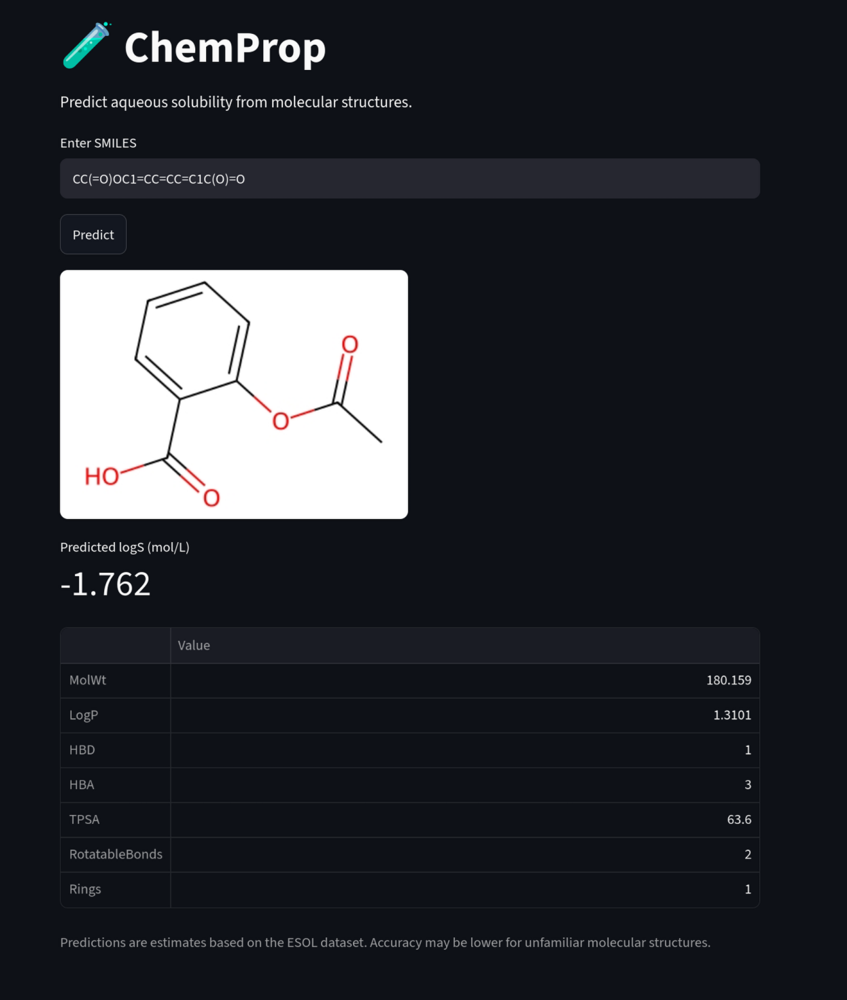
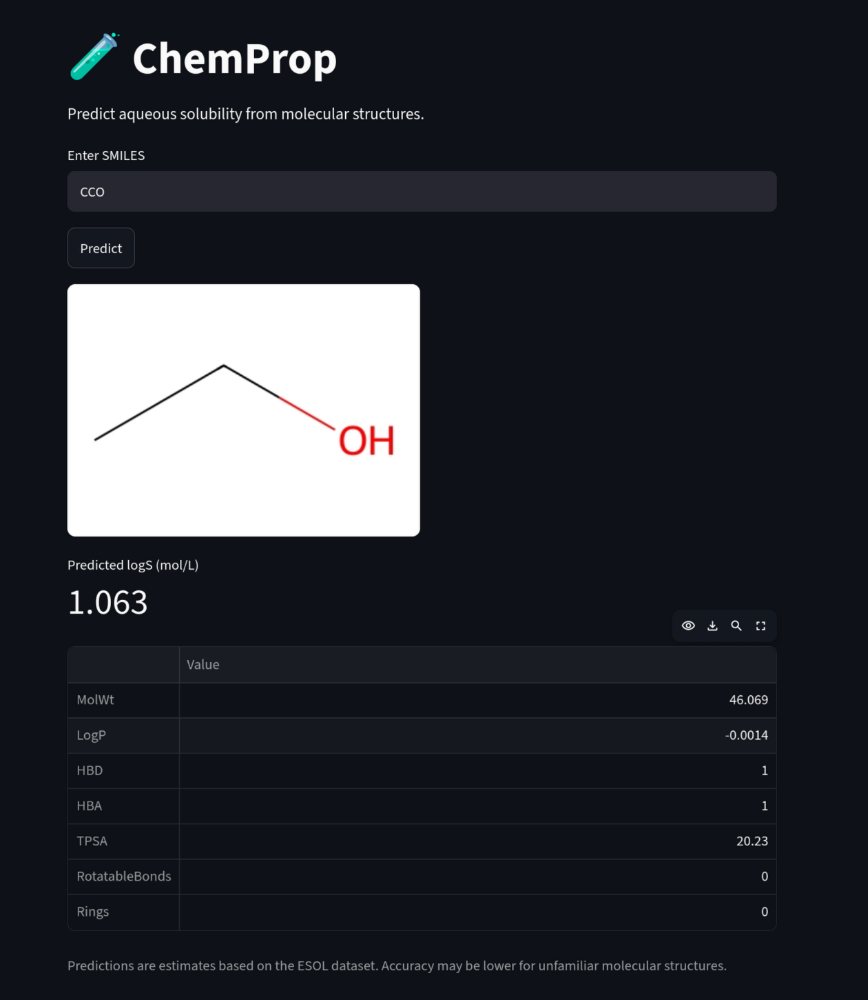

# 🧪 ChemProp: Molecular Solubility Prediction

ChemProp is a cheminformatics and machine-learning project for predicting aqueous molecular solubility from chemical structures.

The project combines RDKit molecular descriptors with machine-learning models to estimate experimentally measured aqueous solubility (logS, mol/L) from SMILES representations.

It includes an exploratory Jupyter notebook, a reproducible model-training pipeline, and an interactive Streamlit application.

## Application Preview

### Aspirin



### Ethanol



## Features

- Molecular parsing and descriptor calculation using RDKit
- Linear Regression and Random Forest models
- Molecular descriptor and permutation importance analysis
- Random train/test and scaffold-based cross-validation
- Interactive solubility prediction from SMILES
- Molecular structure visualisation
- Reproducible environment and model training

## Dataset

The project uses the [Delaney ESOL dataset](https://doi.org/10.1021/ci034243x), containing 1,128 molecules with experimentally measured aqueous solubilities.

**Target:** measured logS (log10 mol/L)

## Methodology

Seven molecular descriptors are calculated using RDKit:

| Descriptor | Description |
|---|---|
| MolWt | Molecular weight |
| LogP | Calculated octanol/water partition coefficient |
| HBD | Hydrogen-bond donors |
| HBA | Hydrogen-bond acceptors |
| TPSA | Topological polar surface area |
| RotatableBonds | Number of rotatable bonds |
| Rings | Number of rings |

The following models and validation approaches were investigated:

- Linear Regression
- Random Forest Regression
- Morgan molecular fingerprints
- Permutation feature importance
- Random train/test splitting
- Murcko scaffold-based validation

## Model Performance

### Random train/test split

An 80/20 split with `random_state=42` was used for initial model evaluation.

| Model | MAE | RMSE | R² |
|---|---:|---:|---:|
| Linear Regression | 0.815 | 1.073 | 0.756 |
| Random Forest | 0.561 | 0.810 | 0.861 |

The Random Forest reduced the mean absolute error by approximately 31% compared with Linear Regression.

### Scaffold-based validation

Murcko scaffolds were used to group molecules according to their core molecular frameworks. GroupKFold cross-validation was then performed to investigate generalisation across different scaffolds.

| Metric | Mean | Standard deviation |
|---|---:|---:|
| MAE | 0.635 | 0.064 |
| RMSE | 0.842 | 0.080 |
| R² | 0.802 | 0.055 |

The scaffold-based evaluation provides a more demanding assessment of structural generalisation than a conventional random split.

### Feature importance

Permutation importance identified LogP as the dominant predictive descriptor, followed by molecular weight and TPSA.

Morgan fingerprints were also investigated, both independently and in combination with molecular descriptors. Combining fingerprints with the seven descriptors did not produce a meaningful improvement in cross-validation performance.

## Interactive Application

ChemProp includes a Streamlit application for interactive predictions.

Users can enter a SMILES representation and obtain:

- Predicted aqueous solubility (logS)
- Rendered molecular structure
- Calculated molecular descriptors

To launch the application:

```bash
python -m streamlit run app.py
```

## Installation

Clone the repository:

```bash
git clone https://github.com/nrahman29/chemprop.git
cd chemprop
```

Create the Conda environment:

```bash
conda env create -f environment.yml
conda activate chemprop
```

Train the model:

```bash
python train_model.py
```

Launch the application:

```bash
python -m streamlit run app.py
```

## Project Structure

```text
chemprop/
├── app.py
├── train_model.py
├── environment.yml
├── data/
│   └── delaney-processed.csv
├── models/
│   └── esol_random_forest.joblib
├── notebooks/
│   └── 01_esol_exploration.ipynb
├── README.md
└── .gitignore
```

The trained model is generated locally by `train_model.py` and is not required to be stored in version control.

## Limitations

- Predictions are estimates based on the chemical space represented in the ESOL dataset.
- Performance may decrease for molecules with unfamiliar scaffolds or chemical functionalities.
- The model uses a relatively small set of calculated molecular descriptors.
- Scaffold-based validation indicates that generalisation to structurally distinct molecules remains challenging.
- Predictions for highly soluble or completely miscible compounds should be interpreted cautiously.

## Future Development

- Image-to-SMILES recognition for chemical structure uploads
- Expanded molecular descriptor sets
- Further model optimisation and external validation
- Improved prediction uncertainty estimation

## Technologies

Python · RDKit · scikit-learn · pandas · NumPy · Matplotlib · Seaborn · Streamlit · Jupyter Notebook

## Author

Navid Rahman

[GitHub Repository](https://github.com/nrahman29/chemprop)
